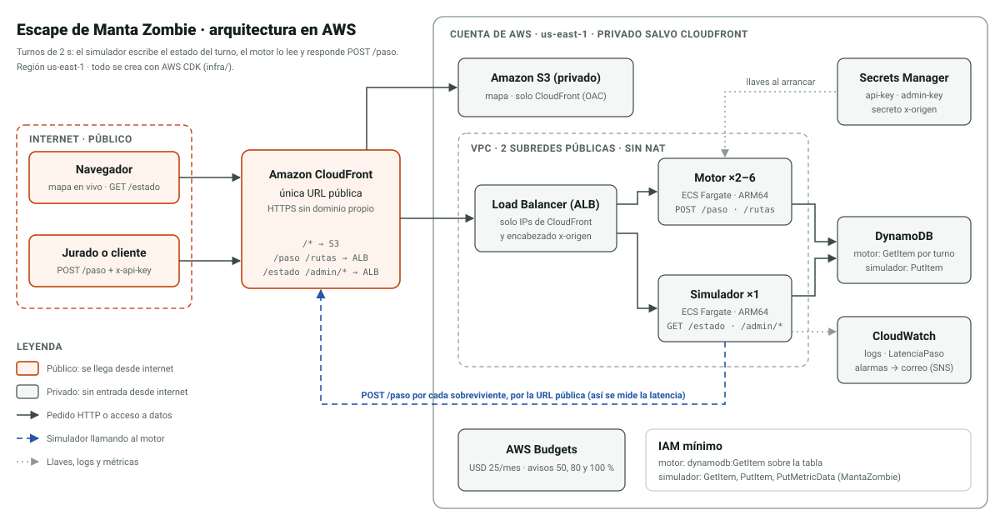
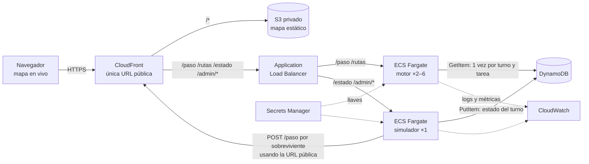
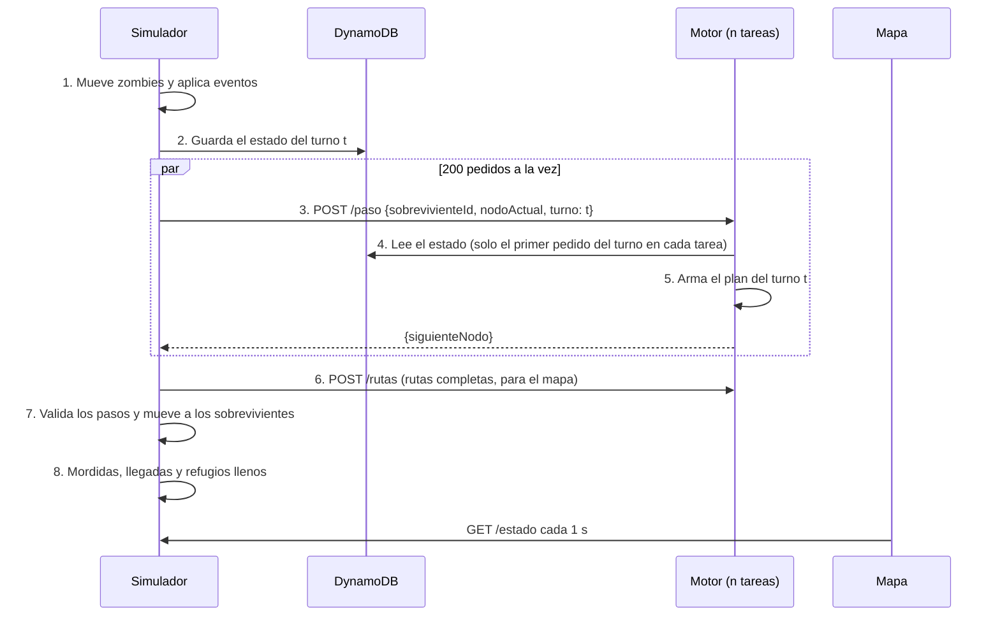

# Spookython · Escape de Manta Zombie

Motor de rutas en tiempo real para el **Track A** del hackatón: la noche del 31 de octubre Manta amanece infestada, y este sistema es la radio que les queda a los sobrevivientes. En cada turno de 2 segundos decide, para cada persona, cuál es su siguiente paso hacia un refugio sin ser mordida y lo antes posible, aunque los zombies se muevan y las calles se cierren mientras camina.

Cambiando «zombie» por «calle cerrada» o «zona inundada», el mismo motor sirve para una ruta de evacuación ante un tsunami en la costa de Manabí, para despachar ambulancias o para una app de delivery.

> **Estado al 27 de octubre de 2026.** El motor de rutas, el simulador y el grafo real de Manta están terminados y probados juntos en local. El mapa en vivo está en construcción, y la infraestructura está escrita pero todavía no está desplegada. La sección [Estado del proyecto](#estado-del-proyecto) dice qué falta.

## Índice

1. [Qué hace](#qué-hace)
2. [Arquitectura](#arquitectura)
3. [Lenguajes y tecnologías](#lenguajes-y-tecnologías)
4. [Estructura del repositorio](#estructura-del-repositorio)
5. [Cada parte en detalle](#cada-parte-en-detalle)
6. [Contrato de la API](#contrato-de-la-api)
7. [Cómo correrlo en tu PC](#cómo-correrlo-en-tu-pc)
8. [Cómo desplegarlo en AWS](#cómo-desplegarlo-en-aws)
9. [Cómo se mide la latencia y el puntaje](#cómo-se-mide-la-latencia-y-el-puntaje)
10. [Decisiones de diseño](#decisiones-de-diseño)
11. [Seguridad](#seguridad)
12. [Costos y AWS Budget](#costos-y-aws-budget)
13. [Limitaciones conocidas](#limitaciones-conocidas)
14. [Si quieres copiarlo o adaptarlo](#si-quieres-copiarlo-o-adaptarlo)
15. [Estado del proyecto](#estado-del-proyecto)
16. [Equipo y créditos](#equipo-y-créditos)

---

## Qué hace

El sistema tiene tres piezas que se hablan por HTTP:

| Pieza | Qué hace |
|---|---|
| **Motor de rutas** | Expone `POST /paso`: recibe `{sobrevivienteId, nodoActual, turno}` y responde `{siguienteNodo}`. La respuesta siempre es un vecino por una calle abierta o el mismo nodo, en menos de 500 ms. |
| **Simulador del Apocalipsis** | Es el dueño del juego. Cada 2 s mueve a los zombies según su tipo, aplica los eventos de la ciudad (un puente que colapsa, calles que se bloquean), le pregunta `/paso` al motor por cada sobreviviente, aplica las mordidas y calcula el puntaje. Publica el estado en `GET /estado`. |
| **Mapa en vivo** | Página web que consulta `GET /estado` cada segundo y dibuja zombies (un ícono por tipo), sobrevivientes, rutas planificadas y refugios. |

### Las reglas del mundo

- **Mapa:** grafo de Manta construido con datos de OpenStreetMap, unas 300 intersecciones y 4 refugios. Cada calle tiene distancia y tipo, y cada tipo su velocidad: avenida 50 km/h, calle 30, callejón 15 y puente 40.
- **Turnos de 2 s:** primero se mueven los zombies y después los sobrevivientes, una calle por turno.
- **Zombies:**

  | Tipo | Comportamiento |
  |---|---|
  | Caminante | 1 calle cada 2 turnos, en dirección aleatoria |
  | Corredor | 2 calles por turno; persigue si hay un sobreviviente a 3 nodos o menos |
  | Horda | Casi inmóvil; bloquea su nodo y todos sus vecinos |
  | Dormido | Invisible hasta que un sobreviviente pasa a 2 nodos o menos; ahí despierta como caminante |

- **Mordida:** termina el turno en el mismo nodo que un zombie, en el nodo de una horda o en un vecino de ella, o se cruza con un zombie por la misma calle en sentido contrario. El mordido sale del juego.
- **Refugios con capacidad:** si un refugio está lleno, el sobreviviente no entra y sigue afuera.

---

## Arquitectura

Todo corre en AWS, en la región **us-east-1** (Norte de Virginia), detrás de una sola URL pública de CloudFront.



El diagrama en draw.io con los íconos oficiales de AWS (`docs/arquitectura.drawio` y `.png`) está en preparación. La fuente actual en Mermaid es [`docs/arquitectura.mmd`](docs/arquitectura.mmd).



**Qué es público:** solo la URL de CloudFront. El balanceador (ALB) solo acepta tráfico de CloudFront: filtra por la lista de IP administrada de CloudFront y exige un encabezado secreto. Los contenedores solo aceptan tráfico del ALB. DynamoDB y Secrets Manager no tienen entrada pública. `/paso`, `/rutas` y `/admin/*` piden llave; `/estado` y el mapa son de solo lectura.

### Qué pasa en un turno



---

## Lenguajes y tecnologías

| Qué | Con qué | Por qué |
|---|---|---|
| Lenguaje | **TypeScript** en todo el proyecto (motor, simulador, mapa e infraestructura) | Un solo lenguaje para los tres integrantes y tipos compartidos entre las piezas |
| Ejecución | **Node.js 22** | Atiende miles de pedidos por segundo en un solo hilo cuando cada pedido cuesta microsegundos |
| Servidor HTTP | `node:http` de Node, sin framework | Menos dependencias y menos latencia; la validación es a mano y estricta |
| Acceso a AWS | AWS SDK para JavaScript v3 (`@aws-sdk/client-dynamodb`, `@aws-sdk/lib-dynamodb`) | Cliente oficial, JavaScript puro, entra en el bundle |
| Compilación | **esbuild** | Un solo archivo `dist/index.cjs` por servicio en menos de un segundo; la imagen de Docker solo copia ese archivo |
| Pruebas | **vitest** | Rápido y con TypeScript sin configuración |
| Contenedores | Docker con `node:22-alpine`, ARM64 (Graviton) | Imagen pequeña, usuario sin privilegios y cómputo un 20 % más barato |
| Infraestructura como código | **AWS CDK** v2 en TypeScript | Toda la nube se crea y se borra con un comando |
| Mapa en vivo | Vite + Leaflet con teselas de CARTO | Liviano y sin llaves de terceros |
| Datos del mapa | OpenStreetMap vía Overpass | Datos abiertos (licencia ODbL) |

Servicios de AWS: CloudFront, S3, Application Load Balancer, ECS Fargate, ECR, DynamoDB, Secrets Manager, CloudWatch (logs, métricas, alarmas y panel), SNS, VPC y AWS Budgets.

---

## Estructura del repositorio

```
├─ README.md
├─ docs/
│  ├─ plan.md              ← plan del equipo: arquitectura, contrato, motor, simulador, mapa
│  ├─ equipo/              ← tareas pendientes de cada persona (A, B y C)
│  ├─ aws.md               ← crear la cuenta, el Budget, desplegar, probar y apagar
│  ├─ costos.md            ← declaración de costos con el cálculo visible
│  ├─ arquitectura.svg     ← diagrama (y .png, .mmd)
│  └─ budget.png           ← captura del AWS Budget (pendiente)
├─ data/
│  ├─ manta.json           ← grafo de Manta: 284 intersecciones, 4 barrios, 4 refugios
│  ├─ raw/                 ← descarga cruda de OpenStreetMap (Overpass)
│  ├─ estado-ejemplo.json  ← un GET /estado real, para el mapa
│  └─ prueba.json          ← grafo de prueba de 10×10 con el mismo formato
├─ scripts/
│  ├─ construir-grafo.ts   ← arma data/manta.json desde OpenStreetMap
│  ├─ banco.ts             ← partidas sin red: motor contra simulador
│  ├─ carga.ts             ← prueba de carga contra POST /paso
│  ├─ copiar-mapa.mjs      ← mete el mapa dentro de la imagen de cada servicio
│  └─ generar-prueba.ts    ← regenera data/prueba.json
├─ src/
│  ├─ compartido/          ← contrato, grafo y reglas que usan el motor y el simulador
│  ├─ motor/               ← POST /paso, POST /rutas y GET /salud
│  └─ simulador/           ← el juego, las rondas, GET /estado y /admin/*
├─ infra/                  ← AWS CDK: todo el sistema en AWS
├─ .env.example            ← variables para correr en local (sin llaves reales)
├─ vitest.config.ts
└─ package.json            ← npm workspaces: src/*
```

---

## Cada parte en detalle

### `src/compartido`: el contrato y las reglas

Código que comparten el motor y el simulador, para que los dos juzguen igual una mordida o un movimiento.

| Archivo | Qué contiene |
|---|---|
| [`tipos.ts`](src/compartido/src/tipos.ts) | El contrato: formato del mapa (`MapaBase`), estado del turno (`EstadoTurno`), pedidos y respuestas de `/paso` y `/rutas`, velocidades por tipo de calle y formato de los ids (`N-0001`, `E-0001`, `S-0001`, `Z-001`, `R-1`). |
| [`grafo.ts`](src/compartido/src/grafo.ts) | Convierte el mapa en un grafo con **índices enteros** y arreglos planos: vecinos de cada nodo, segundos que toma cada calle a la velocidad de su tipo y en qué nodo está cada refugio. Incluye la calle abierta más rápida entre dos nodos (puede haber dos calles entre el mismo par), distancias en calles con BFS y la lectura del mapa. |
| [`reglas.ts`](src/compartido/src/reglas.ts) | Las reglas del reto: `esMovimientoValido` (quedarse o ir a un vecino por calle abierta), `nodosMortales` (nodo con zombie, nodo de horda y todos sus vecinos), `movimientosDeCruce` (si un zombie fue de v a u, ir de u a v es mordida) y `esMordida`. |
| [`cuadricula.ts`](src/compartido/src/cuadricula.ts) | Genera un mapa falso en cuadrícula con avenidas, callejones, un puente y 4 refugios de capacidades 80, 70, 60 y 30. Lo usan las pruebas y `data/prueba.json`. |

### `src/motor`: el motor de rutas

El motor **no guarda estado propio**: lee el estado del turno en DynamoDB, arma un **plan por turno** una sola vez y responde los cientos de pedidos de ese turno con una búsqueda en memoria. En cada turno el plan se rehace entero, así que las rutas siempre reaccionan a dónde están los zombies ahora.

**Cómo se arma el plan del turno** ([`planificador.ts`](src/motor/src/planificador.ts)):

1. **Reglas duras.** Para el paso inmediato quedan prohibidos (salvo que no haya otra opción): un nodo con zombie visible, el nodo de una horda y **todos sus vecinos**, una calle bloqueada y la calle que un zombie acaba de recorrer en sentido contrario. Son exactas porque en ese turno los zombies ya se movieron.
2. **Peligro de cada nodo** (riesgo de quedar acorralado en los próximos turnos):
   - a 1 calle de un caminante: `p1`;
   - a 2 calles o menos de un corredor: `p2` (la mitad a 3 calles);
   - **predicción de corredores:** si un corredor tiene a alguien a 3 nodos o menos, se repite su persecución (BFS hacia el más cercano) y los 2 nodos que recorrerá reciben `p3`;
   - zona de una horda: `pHorda`, porque casi no se mueve;
   - callejón sin salida: `p4`.
3. **Campo de costo por refugio.** Un Dijkstra desde cada refugio, con el costo de ir de `u` a `v`:

   ```
   costo(u→v) = 1 + λ · segundos(u,v) / segundos_promedio + peligro(v)
   ```

   El `1` cuenta turnos (el juego mueve una calle por turno y la eficiencia se mide en turnos), `λ` hace que pesen la distancia y el tipo de calle, y el peligro aleja la ruta de los zombies.
4. **Reparto por capacidad.** El cupo de cada refugio es `capacidad − ocupados`. Primero se asigna a quien más pierde si no va a su mejor refugio (el «arrepentimiento»), y cada uno va al mejor refugio que tenga cupo. Un sobreviviente solo cambia de refugio si el nuevo ahorra más del 20 % (histéresis), para que nadie oscile entre dos. Los empates se deciden por id, así que **todas las tareas del motor dan la misma respuesta**.
5. **El paso.** Entre quedarse y cada vecino por calle abierta, se elige el que minimiza `costo(u→v) + campo_del_refugio(v)`. Lo que termina en mordida solo se elige si no queda otra salida. Si ya llegó a su refugio, se queda.

**Parámetros** (en turnos equivalentes; se ajustan con el banco de pruebas):

| Parámetro | Valor | Qué castiga |
|---|---:|---|
| `lambda` | 0,3 | Calles lentas o largas frente a contar turnos |
| `p1` | 1,5 | Estar a 1 calle de un caminante |
| `p2` | 2,5 | Estar a 2 calles o menos de un corredor |
| `p3` | 6 | Estar en el camino previsto de un corredor que persigue |
| `p4` | 2 | Callejón sin salida |
| `pZombie` | 4 | Pasar más adelante por donde hoy hay un zombie |
| `pHorda` | 30 | Pasar cerca de una horda |
| `histeresis` | 0,2 | Cambiar de refugio por poco ahorro |

**Los demás archivos del motor:**

| Archivo | Qué hace |
|---|---|
| [`planes.ts`](src/motor/src/planes.ts) | Caché de planes por número de turno con **una sola lectura** de la fuente por turno aunque lleguen 200 pedidos juntos (singleflight). Guarda los últimos 3 turnos y vuelve a leer si un plan tiene más de 3 s (cuando empieza otra ronda, los turnos se repiten). Si la lectura falla, el siguiente pedido reintenta. |
| [`fuente-dynamo.ts`](src/motor/src/fuente-dynamo.ts) | Lee el ítem `partida = "actual"` de DynamoDB con lectura fuerte, para ver lo último que escribió el simulador. Tiempo máximo de 300 ms por intento. |
| [`fuente-archivo.ts`](src/motor/src/fuente-archivo.ts) | Lee el estado de un archivo JSON, para probar el motor en local sin DynamoDB. |
| [`index.ts`](src/motor/src/index.ts) | Servidor HTTP: valida la llave con comparación de tiempo constante, valida el cuerpo (1 KB como máximo, ids con formato fijo) y responde. **Si el plan no está listo en 350 ms, responde quedarse**: es un movimiento válido y no pasa de los 500 ms. Escribe a lo sumo un aviso por turno en los logs. |

### `src/simulador`: el Simulador del Apocalipsis

Es el dueño del juego y el que usa el jurado en la prueba de fuego, así que aplica las reglas del reto tal cual, sin trucos a favor del motor.

| Archivo | Qué hace |
|---|---|
| [`juego.ts`](src/simulador/src/juego.ts) | **Núcleo puro del juego**: no toca la red ni el reloj, y con la misma semilla juega siempre la misma partida. Reparte a los sobrevivientes entre los 4 barrios y a los zombies lo más lejos posible de ellos. Mueve a cada tipo de zombie, aplica los eventos de la ciudad y juzga mordidas y llegadas con las mismas reglas compartidas que usa el motor. |
| [`rondas.ts`](src/simulador/src/rondas.ts) | Las 3 rondas: sobrevivientes, zombies de cada tipo y eventos. |
| [`puntaje.ts`](src/simulador/src/puntaje.ts) | Percentiles de latencia y el puntaje estimado con la rúbrica del reto. |
| [`destino.ts`](src/simulador/src/destino.ts) | Guarda el estado de cada turno: en DynamoDB en AWS (con TTL de 1 hora) o en un archivo en local. |
| [`metricas-cloudwatch.ts`](src/simulador/src/metricas-cloudwatch.ts) | Publica la latencia de cada turno como la métrica `LatenciaPaso` en CloudWatch. |
| [`index.ts`](src/simulador/src/index.ts) | Servidor: el bucle de 2 s, `GET /estado` y las rutas de administración. |

**Cómo se mueve cada zombie:**

- **Caminante:** 1 calle cada 2 turnos, a un vecino al azar por una calle abierta.
- **Corredor:** 2 calles por turno. Si alguien está a 3 nodos o menos, lo persigue por el camino más corto (la misma función que usa el motor para predecirlo); si no, camina al azar sin volver atrás.
- **Horda:** 1 calle cada 10 turnos, y nunca a menos de 3 calles de un refugio, para no bloquearlo para siempre.
- **Dormido:** no se mueve ni aparece en el estado. Cuando alguien pasa a 2 nodos o menos, despierta como caminante y se anuncia en los eventos.

**Cada turno** (cada 2 s, compensando el desfase): mueve a los zombies → guarda el estado → pide todos los `POST /paso` en paralelo con un corte de 500 ms → pide `POST /rutas` para el mapa → aplica los pasos (uno inválido, tardío o con error es quedarse quieto) → juzga mordidas y llegadas → publica la latencia. La ronda termina a los 150 turnos o cuando ya nadie huye.

**`GET /estado`** se arma y se comprime con gzip una sola vez por turno, porque el mapa lo consulta cada segundo. Tiene el turno, los zombies visibles, las calles bloqueadas, los sobrevivientes, la ocupación de los refugios, las rutas planificadas, la latencia en vivo, el resultado parcial, el historial de rondas, el puntaje estimado y los últimos eventos. Un ejemplo real, del turno 25 de la ronda 3, está en [`data/estado-ejemplo.json`](data/estado-ejemplo.json).

| Ronda | Sobrevivientes | Zombies | Eventos | Semilla |
|---|---:|---|---|---:|
| R1 · Anochecer | 20 | 15 caminantes | — | 101 |
| R2 · Medianoche | 80 | 20 caminantes, 8 corredores, 3 hordas | Un puente colapsa en el turno 10 | 202 |
| R3 · Apocalipsis | 200 | 30 caminantes, 12 corredores, 4 hordas, 15 dormidos | Dos calles se bloquean (turnos 8 y 16), más las que bloquee el presentador | 303 |

Los eventos van temprano porque en el mapa de Manta casi todos llegan a un refugio en menos de 40 turnos: más tarde, nadie los vería. Al bloquear una calle, el simulador elige una que no deje a nadie sin camino a un refugio y, si puede, cerca de alguien que todavía huye.

### Mapa en vivo (en construcción)

Vite + TypeScript + Leaflet, publicado en S3 detrás de CloudFront. Dibuja las calles por tipo (las bloqueadas en rojo punteado), los refugios con su ocupación, los zombies con un ícono por tipo, los sobrevivientes por color y la ruta planificada de cada uno. Muestra «actualizado hace X s» en rojo si pasan más de 4 s, para que nunca quede congelado sin aviso. Mientras no existe, el stack publica una página provisional ([`infra/sitio-provisional`](infra/sitio-provisional/index.html)).

### `infra`: la nube con AWS CDK

[`infra/lib/manta-stack.ts`](infra/lib/manta-stack.ts) crea todo:

| Recurso | Configuración |
|---|---|
| VPC | 2 zonas de disponibilidad, solo subredes públicas, **sin NAT Gateway** |
| DynamoDB | Una tabla bajo demanda, clave `partida` |
| Secrets Manager | 3 llaves que genera AWS: `x-api-key`, `x-admin-key` y el encabezado secreto entre CloudFront y el ALB |
| ECS Fargate | Motor: 2 tareas ARM64 de 0,25 vCPU y 0,5 GB, autoescalado hasta 6 al 50 % de CPU. Simulador: 1 tarea, nunca dos a la vez |
| ALB | Reglas por ruta; sin el encabezado secreto de CloudFront responde 403 |
| CloudFront + S3 | Una sola URL con HTTPS para el mapa y la API; bucket privado con OAC; la API sin caché |
| CloudWatch | Logs de 7 días, panel con p95 de `/paso`, errores y CPU, y alarmas por latencia y por errores 5xx |
| IAM | Mínimo privilegio: el motor solo puede hacer `GetItem` en la tabla; el simulador, `GetItem` y `PutItem` y publicar métricas en su namespace |

### El grafo de Manta (`data/manta.json`)

Lo arma [`scripts/construir-grafo.ts`](scripts/construir-grafo.ts) (`npm run grafo`) desde OpenStreetMap. La descarga cruda de Overpass queda en `data/raw/overpass-vias.json`, así se puede rearmar aunque Overpass no responda.

1. Toma las vías de una caja que cubre los 4 barrios y los 4 refugios, y las corta en su borde.
2. Las avenidas y calles principales entran todas. Las residenciales entran solo si están cerca de un barrio **caminando por la red**, no en línea recta: así cada barrio queda conectado al resto de la ciudad.
3. Los nodos son las intersecciones; las que están a menos de 25 m se fusionan.
4. Se queda con el componente conexo más grande y quita los nodos de paso (con solo 2 calles), sin juntar nunca un puente con una calle normal.
5. Poda las puntas sin salida que son artificiales (calles que siguen en OpenStreetMap pero quedaron fuera del recorte). Las que quedan son callejones sin salida reales y pasan a ser `callejon`.
6. Ajusta solo el radio alrededor de los barrios hasta quedar cerca de 300 nodos, y valida el resultado: todos los nodos llegan a un refugio, hay al menos un puente y cada barrio tiene 10 nodos o más.

**Resultado:** 284 intersecciones y 481 calles (179 avenidas, 282 calles, 9 callejones y 11 puentes). Ningún nodo está a más de 15 calles de un refugio.

| Barrio | Nodos | Centro (lugar de OpenStreetMap) |
|---|---:|---|
| Tarqui | 84 | Tarqui Centro |
| Jocay | 73 | Jocay |
| Los Esteros | 22 | Los Esteros |
| Barbasquillo | 13 | Barbasquillo |

| Refugio | Capacidad |
|---|---:|
| R-1 · Mall del Pacífico | 80 |
| R-2 · Estadio Municipal Jocay | 70 |
| R-3 · Hospital Rodríguez Zambrano | 60 |
| R-4 · Megaparque Centenario | 30 |

Cada refugio queda en la intersección más cercana al lugar, a entre 134 y 228 m de su centro.

### Los demás scripts

| Script | Comando | Para qué |
|---|---|---|
| [`banco.ts`](scripts/banco.ts) | `npm run banco -- --ronda 3 --partidas 100` | Juega partidas completas con el simulador y el motor en memoria, sin red, y muestra supervivencia y eficiencia. Sirve para ajustar los pesos del motor. |
| [`carga.ts`](scripts/carga.ts) | `URL=… API_KEY=… npm run carga` | Manda 200 `POST /paso` a la vez cada 2 s durante 5 minutos y da el p95 y la tasa de errores con las notas de la rúbrica. |
| [`copiar-mapa.mjs`](scripts/copiar-mapa.mjs) | (lo usa `npm run build`) | Copia el mapa a `dist/mapa.json` del motor y del simulador: usa `data/manta.json` si existe y, si no, `data/prueba.json`. Así el mapa va dentro de la imagen. |
| [`generar-prueba.ts`](scripts/generar-prueba.ts) | `npm run mapa:prueba` | Regenera la cuadrícula de prueba de 10×10. |

---

## Contrato de la API

| Método y ruta | Llave | Entrada → salida |
|---|---|---|
| `POST /paso` | `x-api-key` | `{"sobrevivienteId":"S-0089","nodoActual":"N-0117","turno":142}` → `{"siguienteNodo":"N-0118","refugio":"R-2"}` · `401` sin llave o con llave mala · `400` con cuerpo inválido |
| `POST /rutas` | `x-api-key` | `{"turno":142}` → `{"turno":142,"rutas":{"S-0089":["N-0117","N-0118","…"]}}` |
| `GET /salud` | — | `{"ok":true,"servicio":"motor","nodos":300}` (chequeo del balanceador) |
| `GET /estado` | — | Estado del turno, rutas y métricas en vivo |
| `POST /admin/ronda` | `x-admin-key` | `{"ronda":1,"semilla":42}` → inicia una ronda |
| `POST /admin/bloquear` | `x-admin-key` | `{"arista":"E-0042"}` → bloquea una calle en vivo |
| `POST /admin/detener` | `x-admin-key` | Detiene la ronda |
| `POST /admin/probar-motor` | `x-admin-key` | 50 pedidos a `/paso` por la URL pública, con p50, p95 y máximo |

Si llega un nodo o un sobreviviente desconocido, el motor responde quedarse (`{"siguienteNodo": nodoActual}`) en vez de un error, porque un error cuenta en contra de la disponibilidad.

**Estado del turno** (lo escribe el simulador en DynamoDB y lo lee el motor):

```json
{
  "partida": "actual",
  "ronda": 3,
  "turno": 142,
  "zombies": [{ "id": "Z-017", "tipo": "corredor", "nodo": "N-0117", "recorrido": ["N-0115", "N-0116", "N-0117"] }],
  "aristasBloqueadas": ["E-0042"],
  "sobrevivientes": [{ "id": "S-0089", "nodo": "N-0117", "estado": "huyendo", "refugioAnterior": "R-2" }],
  "refugios": [{ "id": "R-1", "ocupados": 37, "capacidad": 70 }],
  "actualizadoEn": "2026-10-31T23:02:11.204Z"
}
```

`recorrido` lista los nodos por los que pasó cada zombie en el turno (el motor lo usa para no cruzarse con él). Los dormidos no se escriben hasta que despiertan: el motor nunca ve lo que el reto dice que es invisible.

---

## Cómo correrlo en tu PC

Necesitas **Node.js 22 o más nuevo** y npm. Para desplegar también hacen falta Docker Desktop y AWS CLI (ver [`docs/aws.md`](docs/aws.md)).

Instalar las dependencias:

```bash
npm install
```

Correr las pruebas (47 hoy: grafo, reglas, planificador, reparto, rendimiento, caché, juego, puntaje y partidas del motor contra el simulador):

```bash
npm test
```

Compilar el motor y el simulador (cada uno deja `dist/index.cjs` y `dist/mapa.json` con el mapa de Manta):

```bash
npm run build
```

### Probar el motor sin DynamoDB

Guarda este estado como `estado-local.json` en la raíz del repo. Usa la cuadrícula de prueba: un caminante, una horda y dos sobrevivientes.

```json
{
  "partida": "actual", "ronda": 1, "turno": 1,
  "zombies": [
    { "id": "Z-001", "tipo": "caminante", "nodo": "N-0066", "recorrido": ["N-0067", "N-0066"] },
    { "id": "Z-002", "tipo": "horda", "nodo": "N-0033" }
  ],
  "aristasBloqueadas": [],
  "sobrevivientes": [
    { "id": "S-0001", "nodo": "N-0055", "estado": "huyendo" },
    { "id": "S-0002", "nodo": "N-0023", "estado": "huyendo" }
  ],
  "refugios": [
    { "id": "R-1", "ocupados": 0, "capacidad": 80 }, { "id": "R-2", "ocupados": 0, "capacidad": 70 },
    { "id": "R-3", "ocupados": 0, "capacidad": 60 }, { "id": "R-4", "ocupados": 0, "capacidad": 30 }
  ],
  "actualizadoEn": "2026-10-31T23:00:00.000Z"
}
```

Arranca el motor en Git Bash con la cuadrícula de prueba y una llave de prueba cualquiera:

```bash
MAPA=data/prueba.json API_KEY=llave-local ESTADO_ARCHIVO=estado-local.json node src/motor/dist/index.cjs
```

En otra terminal, pide el paso de S-0002, que está pegado a la horda:

```bash
curl -s -X POST http://localhost:8080/paso -H "x-api-key: llave-local" -H "content-type: application/json" -d '{"sobrevivienteId":"S-0002","nodoActual":"N-0023","turno":1}'
```

Responde `{"siguienteNodo":"N-0013","refugio":"R-1"}`: se aleja de la horda antes de seguir hacia su refugio. Para ver las rutas completas:

```bash
curl -s -X POST http://localhost:8080/rutas -H "x-api-key: llave-local" -H "content-type: application/json" -d '{"turno":1}'
```

### Jugar una ronda completa en local

Motor y simulador se hablan por HTTP igual que en AWS; en vez de DynamoDB comparten un archivo con el estado del turno. Abre dos terminales de Git Bash en la raíz del repo. En la primera, el motor:

```bash
API_KEY=llave-local ESTADO_ARCHIVO=estado-turno.json node src/motor/dist/index.cjs
```

En la segunda, el simulador, con turnos de 300 ms para no esperar 5 minutos:

```bash
PUERTO=8081 API_KEY=llave-local ADMIN_KEY=admin-local URL_MOTOR=http://localhost:8080 ESTADO_ARCHIVO=estado-turno.json TURNO_MS=300 node src/simulador/dist/index.cjs
```

Empieza la ronda 3 (también se puede pasar `"semilla"`):

```bash
curl -s -X POST http://localhost:8081/admin/ronda -H "x-admin-key: admin-local" -H "content-type: application/json" -d '{"ronda":3}'
```

Bloquea una calle en vivo, como el presentador:

```bash
curl -s -X POST http://localhost:8081/admin/bloquear -H "x-admin-key: admin-local" -H "content-type: application/json" -d '{"arista":"E-0100"}'
```

Mira el estado, que es lo que dibuja el mapa (al terminar, el resultado queda en `historial` y en `puntaje`):

```bash
curl -s http://localhost:8081/estado
```

Para medir el motor sin red y con muchas partidas, usa el banco:

```bash
npm run banco -- --partidas 30
```

| Variable | Servicio | Para qué |
|---|---|---|
| `PUERTO` | Los dos | Puerto del servidor (8080 por defecto) |
| `API_KEY` | Los dos | Llave de `x-api-key` en `/paso` y `/rutas`. En AWS viene de Secrets Manager |
| `ADMIN_KEY` | Simulador | Llave de `x-admin-key` en `/admin/*`. En AWS viene de Secrets Manager |
| `URL_MOTOR` | Simulador | Dónde está el motor. En AWS es la URL pública de CloudFront, como la usaría el jurado |
| `TABLA_MUNDO` | Los dos | Tabla de DynamoDB con el estado. En AWS la pone el stack |
| `ESTADO_ARCHIVO` | Los dos | Solo en local: archivo JSON con el estado, en vez de DynamoDB |
| `DYNAMO_ENDPOINT` | Los dos | Solo en local: DynamoDB Local (por ejemplo `http://localhost:8000`) |
| `TURNO_MS` | Simulador | Duración del turno (2000 por defecto) |
| `MAPA` | Los dos | Otro mapa base (por defecto `dist/mapa.json`) |

---

## Cómo desplegarlo en AWS

La guía completa, con cada comando y qué hacer si algo falla, está en [`docs/aws.md`](docs/aws.md). En resumen:

1. Crear la cuenta de AWS y activar MFA en el usuario root.
2. **Crear el AWS Budget en la consola** antes que nada (mensual de USD 25, con alerta por correo).
3. Instalar AWS CLI 2.32 o más nueva e iniciar sesión con `aws login`, que da credenciales temporales sin crear *access keys*.
4. Con Docker Desktop abierto, preparar la cuenta una sola vez (`npx cdk bootstrap`) y desplegar:

   ```bash
   npm run desplegar
   ```

5. El despliegue imprime la URL pública (`Url`), el endpoint `POST /paso` (`UrlPaso`) y los ARN de los secretos de donde se leen las llaves.
6. Al terminar el evento, apagar todo:

   ```bash
   npm run destruir
   ```

**URL pública:** _(se completa después del primer despliegue)_ · **Endpoint `POST /paso`:** _(ídem)_

---

## Cómo se mide la latencia y el puntaje

- **Fuente oficial:** el simulador cronometra cada `POST /paso` contra la URL pública, igual que lo haría el jurado, desde que envía hasta que recibe la respuesta. Calcula p50, p95 y p99 por ronda. Un pedido de más de 500 ms o con error cuenta como fuera de tiempo. Publica la métrica `LatenciaPaso` en CloudWatch.
- **Contraste:** el p95 de `TargetResponseTime` del balanceador en el panel de CloudWatch (solo el tiempo dentro de AWS) y la prueba de carga de 200 pedidos a la vez cada 2 s.
- **Banco, en el mapa de Manta** (30 partidas por ronda, sin red): supervivencia de 100 % en R1, 94 % en R2 y 62 % en R3, con eficiencia de 95 %, 86 % y 84 %. El motor tarda 0,3 ms por turno en decidir los pasos de los 200 sobrevivientes.
- **Las 3 rondas en local, por HTTP** (semillas 101, 202 y 303, motor y simulador compilados en la misma PC): R1 20 de 20 a salvo, R2 80 de 80, R3 100 de 200, sin errores ni pedidos fuera de tiempo, con un p95 de 18, 19 y 129 ms. Puntaje estimado: **8,5 de 10**. En AWS se suma el tiempo de CloudFront y del balanceador.

Puntaje de la prueba de fuego, que el simulador calcula con la misma rúbrica:

| Criterio | Peso | Cálculo |
|---|---:|---|
| Supervivencia | 50 % | Salvados por ronda, ponderados R1 ×1, R2 ×2, R3 ×3 |
| Eficiencia | 20 % | Turnos usados frente a la ruta más corta sin zombies |
| Latencia | 15 % | p95 ≤ 150 ms → 10 · ≤ 300 ms → 7 · ≤ 500 ms → 4 |
| Disponibilidad | 15 % | Errores o fuera de tiempo < 0,5 % → 10 · < 2 % → 6 · < 5 % → 3 |

---

## Decisiones de diseño

| Decisión | Por qué |
|---|---|
| ECS Fargate y no Lambda | No hay arranques en frío en la ronda 3, ni el límite de ejecuciones simultáneas de una cuenta nueva. Un contenedor de Node atiende miles de pedidos por segundo cuando cada uno cuesta microsegundos. |
| Plan por turno + caché | El plan se arma una vez por turno y por tarea, y se reutiliza para los 200 pedidos de ese turno. Se rehace entero en cada turno: nunca se calcula la ruta una sola vez. |
| Estado en DynamoDB, no en memoria | Es la única fuente de verdad para todas las tareas del motor. Cada tarea cachea solo el plan de un turno, que no cambia una vez escrito, así que ninguna puede quedarse con una copia distinta. |
| Reglas compartidas | El motor y el simulador usan el mismo código para juzgar mordidas y movimientos. |
| Horda: nodo y vecinos prohibidos | Es la lectura más estricta de «bloquea su nodo y todos los vecinos». |
| Quedarse si el plan tarda | Un movimiento inválido o tardío equivale a quedarse, pero un error resta disponibilidad: es mejor responder quedarse a tiempo. |
| El grafo va dentro de la imagen | El mapa base no cambia; lo que cambia (zombies, calles bloqueadas) va en el estado del turno. |
| CloudFront delante de todo | HTTPS gratis sin comprar dominio, y una sola URL para el mapa y la API, sin problemas de CORS. |
| Subredes públicas sin NAT | Ahorra unos USD 33 al mes. Las tareas tienen IP pública, pero su grupo de seguridad solo acepta al balanceador. |
| El simulador corre en AWS | Desde una laptop en Manta se sumarían unos 100 ms de red hasta Virginia y se arruinaría el p95. |

---

## Seguridad

- **Sin llaves en el código.** Las genera AWS en Secrets Manager y llegan a los contenedores como variables de entorno. En el repo solo hay un `.env.example` con valores de ejemplo.
- **Llaves separadas:** una para `/paso` y `/rutas`, otra para `/admin/*`. Se comparan en tiempo constante (`timingSafeEqual`) y un 401 no da detalles.
- **Validación estricta:** cuerpo de 1 KB como máximo e ids con formato fijo.
- **Red cerrada:** CloudFront → ALB (con lista de IP y encabezado secreto) → tareas (solo desde el ALB).
- **Mínimo privilegio en IAM**, con permisos escritos acción por acción para cada rol.
- **Contenedores** con el disco de solo lectura y un usuario sin privilegios.
- **Cuenta:** root con MFA. La CLI usa credenciales temporales de `aws login` (hasta 12 horas): no hay *access keys* guardadas que se puedan filtrar.

---

## Costos y AWS Budget

Con todo encendido las 24 horas en us-east-1, el sistema cuesta **unos USD 60 al mes (USD 2 por día)**. Lo que más pesa es fijo: el balanceador y las IP públicas. Un pedido más a `/paso` cuesta prácticamente cero. El cálculo línea por línea, lo que se ahorró con cada decisión y el gasto real del evento están en [`docs/costos.md`](docs/costos.md).

**AWS Budget:** presupuesto mensual `manta-zombie-mensual` de USD 25, con alerta por correo cuando el gasto real o el pronosticado lo supera. La captura irá en `docs/budget.png` _(pendiente)_.

---

## Limitaciones conocidas

- **Pesos sin ajustar.** Los valores de `p1` a `p4`, `λ` y la histéresis son una primera estimación. El banco ya funciona, pero todavía no se usó para ajustarlos; la ronda 3 es la que más puede mejorar.
- **Un grafo recortado.** Manta tiene miles de intersecciones; el juego usa unas 300 alrededor de los barrios y los refugios, como pide el reto. Barbasquillo queda con menos nodos (13) que Tarqui (84).
- **DynamoDB y CloudWatch no se han probado contra AWS real**; en local, motor y simulador comparten un archivo en vez de la tabla.
- **Las rondas duran menos de 5 minutos**: terminan cuando ya nadie huye, y en este mapa eso pasa antes de los 40 turnos.
- **Los dormidos son invisibles** por diseño: el motor no puede evitar uno que todavía no despertó.
- **Un solo simulador.** Es el dueño del juego y no se replica.
- **Una sola región.** Si us-east-1 falla, el sistema se cae; para el hackatón no vale la pena pagar otra región.
- **Sin flota de rescate.** El reto la ofrece como punto extra (5 camionetas); quedó fuera por el plazo.

---

## Si quieres copiarlo o adaptarlo

El motor no sabe nada de zombies: sabe de un grafo, de obstáculos que se mueven y de destinos con capacidad. Para usarlo en otro problema:

### 1. Cambia el mapa

Arma el grafo de tu ciudad con el mismo formato de `data/manta.json` (nodos con lat y lng, aristas con `distancia_m` y `tipo`, refugios con capacidad) a partir de OpenStreetMap, con Overpass o con OSMnx. Revisa que el grafo sea conexo y que todos los nodos lleguen a algún destino. Si tus calles tienen otros tipos o velocidades, cámbialos en `VELOCIDAD_KMH` de [`tipos.ts`](src/compartido/src/tipos.ts).

### 2. Traduce los zombies a tu problema

| En el juego | En una evacuación o un despacho |
|---|---|
| Arista bloqueada | Calle cerrada, puente caído, accidente |
| Horda (nodo y vecinos prohibidos) | Zona inundada, incendio, derrumbe |
| Caminante o corredor | Peligro que se mueve: una crecida, una multitud, el tráfico |
| Refugio con capacidad | Albergue, hospital con camas libres, punto de encuentro |
| Sobreviviente | Persona que evacúa, ambulancia, repartidor |

### 3. Ajusta los pesos con datos

Los parámetros del planificador están en un solo objeto (`PARAMETROS`). No los cambies a ojo: arma un banco que simule muchas partidas con semilla fija y quédate con los valores que mejor equilibran supervivencia y eficiencia.

### 4. Si la ciudad es mucho más grande

Con 300 nodos, cada Dijkstra tarda menos de 1 ms y el plan completo unos pocos. Con decenas de miles de nodos:

- calcula el campo solo hacia los destinos que importan, o usa A* desde cada persona;
- divide la ciudad en zonas y deja que cada tarea atienda una;
- mantén el diseño sin estado propio: con eso, escalar es agregar tareas.

### 5. Si lo vas a poner en producción

- **Región:** elige la más cercana a tus usuarios y mide la latencia real antes de decidir.
- **Dominio propio** con certificado de ACM en CloudFront, y **AWS WAF** contra abusos.
- **Subredes privadas con NAT** o VPC endpoints, en vez de IP públicas en las tareas.
- **Rotación automática de las llaves** en Secrets Manager, o API Gateway con planes de uso si hay muchos clientes.
- **WebSocket** (API Gateway o AppSync) en vez de consultar `/estado` cada segundo.
- **Con poco tráfico**, Lambda con concurrencia aprovisionada o App Runner pueden salir más baratos que un balanceador encendido todo el mes.

### 6. Antes de desplegarlo en tu cuenta

- Crea el **AWS Budget** primero.
- Revisa en *Service Quotas* el cupo de vCPU de Fargate.
- Ejecuta `npm run destruir` cuando ya no lo uses: el balanceador y las IP públicas cobran aunque nadie lo use.

### 7. Licencias

Los datos del mapa vienen de OpenStreetMap y están bajo licencia **ODbL**: hay que dar el crédito «© OpenStreetMap contributors» en el mapa y en la documentación. El equipo todavía no ha elegido una licencia para el código. Hasta que haya un archivo `LICENSE`, pregunta antes de reutilizarlo.

---

## Estado del proyecto

| Parte | Estado |
|---|---|
| Plan, contrato y reparto del equipo | ✅ [`docs/plan.md`](docs/plan.md) y [`docs/equipo/`](docs/equipo/) |
| Motor de rutas (`/paso`, `/rutas`, plan por turno, predicción, capacidad) | ✅ Probado |
| Grafo real de Manta (`data/manta.json`) | ✅ 284 intersecciones desde OpenStreetMap |
| Simulador (juego, rondas, eventos, `/estado`, `/admin/*`, puntaje, métrica) | ✅ Probado con el motor en local |
| Banco de pruebas y prueba de carga | ✅ · ⏳ falta usarlos para ajustar los pesos |
| Infraestructura en CDK | ✅ Escrita y compila · ⏳ sin desplegar |
| Mapa en vivo | ⏳ En construcción (ya tiene `data/estado-ejemplo.json`) |
| Diagrama en draw.io, captura del Budget y gasto real | ⏳ Pendientes |

---

## Equipo y créditos

| Rol | Persona | Se encarga de |
|---|---|---|
| A · Motor | _(nombre)_ | Contrato, motor de rutas, pruebas y presentación |
| B · Mundo | _(nombre)_ | Grafo de Manta, simulador, puntaje y video |
| C · Nube y producto | _(nombre)_ | AWS, mapa en vivo, diagrama, costos y README |

Datos de calles: © [OpenStreetMap contributors](https://www.openstreetmap.org/copyright), bajo licencia ODbL. Teselas del mapa: © CARTO.

Hecho para el hackatón **Escape de Manta Zombie** · Manta, Ecuador · octubre de 2026.
