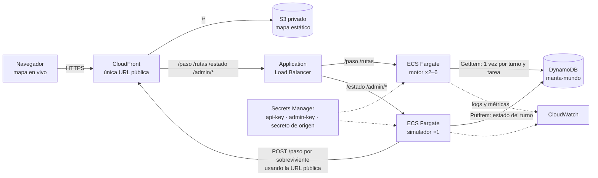
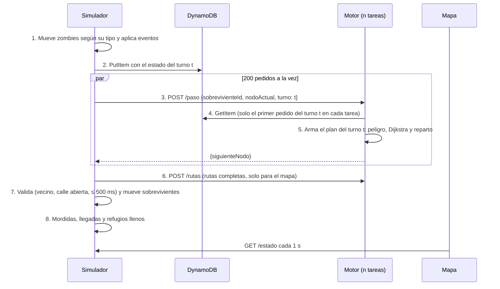

# Plan de trabajo: Escape de Manta Zombie (Track A)

**Equipo:** 3 personas · **Entrega:** miércoles 28 de octubre de 2026 a las **10:00** (hora de Ecuador) · **Demo:** viernes 30 en la ULEAM (5 min de pitch + 3 de preguntas) · **Plan escrito:** lunes 26 de octubre; reparto actualizado el martes 27.

Ya existen la infraestructura en CDK (`infra/`), la guía de despliegue ([`docs/aws.md`](aws.md)), la estimación de costos ([`docs/costos.md`](costos.md)), un diagrama provisional en Mermaid y esqueletos desplegables del motor y del simulador que cumplen el contrato pero no juegan. Falta todo lo que juega: grafo, motor, simulador y mapa.

**Cada persona tiene su hoja** con todas sus tareas pendientes, lo que recibe y entrega, cuándo está «listo» y un encargo listo para pegar en su asistente de IA:

| Persona | Hoja |
|---|---|
| A · Motor | [`docs/equipo/persona-a.md`](equipo/persona-a.md) |
| B · Mundo | [`docs/equipo/persona-b.md`](equipo/persona-b.md) |
| C · Nube y producto | [`docs/equipo/persona-c.md`](equipo/persona-c.md) |

---

## 0. Resumen en 30 segundos

Son tres piezas en TypeScript, desplegadas en AWS en la región **us-east-1** y servidas desde una sola URL pública de CloudFront:

| Pieza | Qué hace | Dónde corre |
|---|---|---|
| **Motor** (`POST /paso`) | Decide el siguiente nodo de cada sobreviviente. No guarda estado propio: lee el estado del turno en DynamoDB y lo cachea por número de turno. | ECS Fargate, de 2 a 6 contenedores siempre encendidos |
| **Simulador** | Es el dueño del juego. Cada 2 s mueve los zombies, guarda el turno en DynamoDB, pregunta `/paso` por cada sobreviviente, mide la latencia y calcula el puntaje. Publica `GET /estado`. | ECS Fargate, 1 contenedor |
| **Mapa en vivo** | Página con Leaflet que consulta `GET /estado` cada segundo y dibuja zombies, sobrevivientes, rutas y refugios. | S3 + CloudFront |

**Metas medibles:** p95 de `/paso` por debajo de 60 ms medido desde el simulador (la nota máxima pide ≤ 150 ms), menos de 0,5 % de errores y supervivencia creciente en cada ensayo, medida con semillas fijas.

---

## 1. Quién hace qué

| Rol | Persona | Dueño de | Debe poder explicar en el pitch |
|---|---|---|---|
| **A · Motor** | _(nombre)_ | `src/compartido` (tipos, grafo, reglas), `src/motor` (`POST /paso`, `POST /rutas`), pruebas, banco, **presentación PDF** | Plan por turno, Dijkstra, horda + vecinos, predicción de corredores, reparto por capacidad |
| **B · Mundo** | _(nombre)_ | `scripts/construir-grafo.ts`, `data/`, `src/simulador` (juego, rondas, `GET /estado`, `/admin/*`, puntaje, latencia), `scripts/carga.ts`, **video de respaldo** | Grafo desde OpenStreetMap, reglas de los zombies, cómo se mide la latencia y el puntaje |
| **C · Nube y producto** | _(nombre; quien tiene la PC con el CDK)_ | Cuenta AWS, Budget, `infra/`, despliegue, `docker-compose.yml`, `src/mapa`, **diagrama en draw.io**, `docs/costos.md`, README integrado, repo público | Arquitectura, seguridad, costos y por qué Fargate y no Lambda |

Reglas del equipo:

- **Cualquiera debe poder explicar cualquier parte** (lo exige el reto). Cada PR lo revisa otra persona, y antes del pitch hay una sesión cruzada en la que cada quien explica el módulo de otro.
- El pitch se presenta entre los tres: cada uno cuenta su parte.
- El contrato de la [sección 4](#4-contrato-interno) no cambia sin avisar a los otros dos.
- Commits pequeños y frecuentes **de los tres**, porque el reto pide un historial real.

---

## 2. Tareas pendientes

Esto es todo lo que falta, separado por persona. Cada quien toma su lista y la trabaja en el orden en que aparece: las primeras tareas de cada lista son las que los otros dos necesitan para avanzar. El detalle, el criterio de «listo» y el encargo para el asistente de IA están en la hoja de cada uno.

### Todos

- Cerrar juntos las [decisiones de la sección 15](#15-decisiones-del-arranque) antes de empezar.
- Hacer commits pequeños, cada uno con su cuenta, en el repo público.
- Integrar las tres piezas y correr R1, R2 y R3 completas en AWS; anotar los números en `docs/resultados.md`.
- Antes de entregar: tag `v1.0`, gitleaks y revisar que el README enlaza todo.
- Subir la entrega en la plataforma (*Mi equipo → Entrega*) antes del **miércoles 28 a las 10:00**.
- Ensayar el pitch y hacer la sesión cruzada: cada uno explica el módulo de otro.
- Día de la demo: motor a 3 tareas, ronda de calentamiento, panel de CloudWatch abierto, video de respaldo y hotspot del celular.

### A · Motor ([hoja](equipo/persona-a.md))

1. `src/compartido/tipos.ts` con el contrato de la [sección 4](#4-contrato-interno).
2. Carga del grafo, vecinos, arista entre dos nodos y `esMovimientoValido`.
3. Reglas duras con pruebas: zombie visible, horda **y sus vecinos**, arista bloqueada y cruce por `recorrido`.
4. Costo blando (P1, P2, P4) y Dijkstra desde cada refugio con λ.
5. Elección del paso y `POST /paso` real.
6. Caché por turno con singleflight y lectura de DynamoDB.
7. `POST /rutas` para que el mapa dibuje las rutas.
8. Banco sin red con el `juego.ts` de B.
9. PRO: predicción de corredores.
10. PRO: reparto por capacidad con histéresis.
11. Ajuste de λ y P1–P4 con el banco; resultados en `docs/resultados.md`.
12. README: algoritmo, decisiones del motor y limitaciones.
13. Presentación en PDF (20 MB o menos) con las diapositivas de B y C.

### B · Mundo ([hoja](equipo/persona-b.md))

1. `data/prueba.json`: grafo falso de 10×10.
2. `scripts/construir-grafo.ts` → `data/raw/` → `data/manta.json` validado, con barrios y los 4 refugios.
3. `juego.ts` puro: caminante, corredor, horda, dormido y el `recorrido` de cada zombie.
4. Mordidas, llegadas a refugios con capacidad, eventos (puente, calles), semillas y las 3 rondas.
5. `data/estado-ejemplo.json` con la forma de `GET /estado`, para el mapa.
6. Servidor del simulador: bucle de 2 s, PutItem, `/paso` en paralelo, `/rutas`, `GET /estado` y `/admin/*`.
7. Métricas p50/p95/p99, errores, puntaje con la rúbrica y `LatenciaPaso` en CloudWatch.
8. `scripts/carga.ts`.
9. Ensayo de R1, R2 y R3 en AWS con las semillas definitivas.
10. README: URL de `POST /paso`, cómo ejecutar el simulador y cómo se mide la latencia.
11. Diapositivas de números y capturas para el PDF.
12. Video de respaldo de una ronda completa (opcional).

### C · Nube y producto ([hoja](equipo/persona-c.md))

1. Primer commit, repo **público** en GitHub y sumar a A y B.
2. Cuenta AWS: MFA, IAM Identity Center, AWS CLI y cupo de Fargate.
3. Budget en la consola y `docs/budget.png`.
4. Quitar de `infra/bin/app.ts` el import roto de `presupuesto-stack.ts` y el script `presupuesto` de `package.json`.
5. `cdk bootstrap` y primer despliegue con los esqueletos: URL pública para que A y B prueben.
6. Activar la etiqueta de costos `proyecto`.
7. `docker-compose.yml` con motor, simulador y DynamoDB Local.
8. Mapa base en `src/mapa`: Manta, calles, refugios, zombies, sobrevivientes y leyenda.
9. Mapa completo: rutas, panel, «actualizado hace X s», animación y modo presentador.
10. Desplegar las imágenes reales y revisar el panel de CloudWatch.
11. Diagrama en draw.io con los íconos de AWS: `docs/arquitectura.drawio` + `.png` y `.svg`.
12. `docs/costos.md` confirmado con la calculadora de AWS y con el gasto real de Cost Explorer.
13. README de la raíz, integrando las secciones de A y B.
14. Diapositivas de arquitectura y costos para el PDF.
15. Después del pitch: `npm run destruir` y anotar el gasto final.

### Qué se pasan entre ustedes

| Qué | De → para | Para qué |
|---|---|---|
| `src/compartido/tipos.ts` | A → B y C | Todos programan contra el mismo contrato |
| `data/prueba.json` | B → A y C | Probar sin esperar el grafo real |
| `data/manta.json` | B → A y C | El motor y el mapa usan el grafo real |
| URL pública con esqueletos | C → A y B | Probar en AWS desde temprano, no el día de la entrega |
| `src/simulador/juego.ts` | B → A | El banco del motor |
| `data/estado-ejemplo.json` | B → C | Dibujar el mapa sin tener el simulador corriendo |
| Forma de la respuesta de `/rutas` | A → C | Dibujar las rutas planificadas |
| `docker-compose.yml` | C → A y B | Probar las tres piezas juntas en local |
| Diapositivas | B y C → A | Armar el PDF |

Lo que la nube exige del motor y del simulador ya está en la [sección 5 de `docs/aws.md`](aws.md#5-lo-que-la-nube-espera-del-motor-y-del-simulador): un solo bundle, puerto 8080, `GET /salud`, disco de solo lectura y keep-alive de 65 s.

---

## 3. Arquitectura



**Qué es público:** solo la URL de CloudFront. El ALB solo acepta tráfico de CloudFront (lista de prefijos administrada y un encabezado secreto). Los contenedores solo aceptan tráfico del ALB. DynamoDB y Secrets Manager no tienen entrada pública. `/paso`, `/rutas` y `/admin/*` exigen llave; `/estado` y el mapa son de solo lectura y abiertos.

| Decisión | Por qué |
|---|---|
| Fargate y no Lambda | No hay arranques en frío. Las cuentas nuevas de AWS suelen tener un límite de 10 Lambdas simultáneas y la ronda 3 manda 200 pedidos a la vez. Un contenedor de Node atiende miles de pedidos por segundo cuando cada uno cuesta microsegundos. |
| Estado en DynamoDB | Es la única fuente de verdad para todas las tareas del motor. Cada tarea cachea el plan **por número de turno**, que no cambia una vez escrito, así que ninguna puede quedarse con una copia distinta. |
| Un solo ítem por partida | Una escritura por turno y una lectura por turno por tarea. Cuesta centavos. |
| El grafo va dentro de la imagen | El mapa base no cambia. Lo que cambia (zombies, calles bloqueadas) va en el estado del turno. |
| CloudFront delante del ALB | HTTPS gratis sin comprar dominio, y una sola URL para el mapa y la API, sin CORS. |
| Subredes públicas sin NAT | Ahorra unos USD 33 al mes. Los contenedores tienen IP pública, pero su grupo de seguridad solo acepta al ALB. |
| El simulador corre en AWS | Desde una laptop en Manta se sumarían unos 100 ms de red hasta Virginia y se arruinaría el p95. |

### Flujo de un turno (cada 2 s)



---

## 4. Contrato interno

Vive en `src/compartido/tipos.ts` y lo usan el motor, el simulador y el mapa. Lo escribe A antes que nada, porque B y C lo usan.

### Mapa base: `data/manta.json`

```json
{
  "nodos":    [{ "id": "N-0001", "lat": -0.9521, "lng": -80.7302, "barrio": "Tarqui" }],
  "aristas":  [{ "id": "E-0001", "a": "N-0001", "b": "N-0002", "distancia_m": 143.2, "tipo": "avenida", "nombre": "nombre de OSM" }],
  "refugios": [{ "id": "R-1", "nodo": "N-0150", "nombre": "…", "capacidad": 70 }]
}
```

Las calles son de doble sentido (los sobrevivientes van a pie). Los ids tienen formato fijo: `N-0000`, `E-0000`, `S-0000`, `Z-000` y `R-0`.

| Tipo | Etiquetas `highway` de OSM | Velocidad (propuesta) |
|---|---|---|
| `avenida` | trunk, primary, secondary | 50 km/h |
| `calle` | tertiary, residential, unclassified | 30 km/h |
| `callejon` | service, living_street, alley, footway | 15 km/h |
| `puente` | cualquiera con `bridge=yes` | 40 km/h |

### Estado del turno: ítem de DynamoDB (`PK partida = "actual"`)

```json
{
  "partida": "actual",
  "ronda": 3,
  "turno": 142,
  "zombies": [
    { "id": "Z-017", "tipo": "corredor", "nodo": "N-0117", "recorrido": ["N-0115", "N-0116", "N-0117"] }
  ],
  "aristasBloqueadas": ["E-0042"],
  "sobrevivientes": [{ "id": "S-0089", "nodo": "N-0117", "estado": "huyendo", "refugioAnterior": "R-2" }],
  "refugios": [{ "id": "R-1", "ocupados": 37, "capacidad": 70 }],
  "actualizadoEn": "2026-10-30T15:02:11.204Z"
}
```

- `recorrido` lista los nodos por los que pasó el zombie en este turno. El motor lo necesita para no **cruzarse** con un zombie en la misma calle.
- `refugioAnterior` es el refugio que el motor eligió en el turno anterior. Permite la histéresis del reparto sin guardar nada en la memoria del motor.
- **Los dormidos nunca se escriben** ni en DynamoDB ni en `/estado` hasta que despiertan. El motor no hace trampa.
- El ítem pesa unos 15 KB con 200 sobrevivientes; el límite de DynamoDB es 400 KB.

### Endpoints

| Método y ruta | Llave | Entrada → salida |
|---|---|---|
| `POST /paso` | `x-api-key` | `{"sobrevivienteId":"S-0089","nodoActual":"N-0117","turno":142}` → `200 {"siguienteNodo":"N-0118","refugio":"R-2"}` · `401` con llave mala · `400` con cuerpo inválido |
| `POST /rutas` | `x-api-key` | `{"turno":142}` → `{"rutas":{"S-0089":["N-0117","N-0118","…"]}}` (solo para dibujar) |
| `GET /salud` | — | `200` (chequeo del ALB) |
| `GET /estado` | — | Estado del turno, rutas, métricas en vivo y `actualizadoEn` |
| `POST /admin/ronda` | `x-admin-key` | `{"ronda":1,"semilla":42}` → inicia la ronda |
| `POST /admin/bloquear` | `x-admin-key` | `{"arista":"E-0042"}` → bloquea una calle en vivo |
| `POST /admin/detener` | `x-admin-key` | Detiene la ronda |
| `POST /admin/probar-motor` | `x-admin-key` | Ya existe en el esqueleto: 50 pedidos a `/paso` por la URL pública con p50, p95 y máximo |

Si el `turno` pedido es más nuevo que el que hay en caché, el motor vuelve a leer DynamoDB (lectura fuerte). Si llega un nodo o un sobreviviente desconocido, responde `{"siguienteNodo": nodoActual}` en vez de un error, porque un 5xx cuenta en contra de la disponibilidad.

---

## 5. Motor de rutas (A)

El motor arma un **plan por turno** una sola vez por tarea y lo reutiliza para los cientos de pedidos de ese turno. Cada turno se recalcula entero, que es justo lo que pide el jurado.

1. **Reglas duras.** Son destinos prohibidos en este turno, y son exactas porque los zombies ya se movieron:
   - un nodo con un zombie visible;
   - el nodo de una horda **y todos sus vecinos**;
   - una arista bloqueada;
   - la calle que un zombie acaba de recorrer en sentido contrario, según su `recorrido`.
2. **Costo blando.** Mide el riesgo de quedar acorralado en los próximos turnos:
   - **Caminante:** penalización P1 en los nodos a 1 calle.
   - **Corredor:** penalización P2 en los nodos a 2 calles o menos.
   - **Corredor con predicción (PRO):** si tiene un sobreviviente a 3 nodos o menos, se simula su persecución (2 pasos por BFS hacia el más cercano) y esos nodos reciben P3, muy alta.
   - **Callejón sin salida** (nodo de grado 1): penalización P4.
3. **Campo de costo por refugio.** Un Dijkstra desde cada refugio (4 en total) con `costo(u→v) = 1 + λ · tiempo(u,v) / tiempo_medio + peligro(v)`.
   - El `1` cuenta turnos: el juego mueve una calle por turno y la eficiencia se mide en turnos.
   - `λ` hace que pesen la distancia y el tipo de calle (requisito del nivel base), y el banco decide su valor.
   - Con unos 300 nodos, cada Dijkstra tarda menos de 1 ms.
4. **Reparto por capacidad (PRO).**
   - Cupo de cada refugio = `capacidad − ocupados`.
   - Se ordena a los sobrevivientes por «arrepentimiento» (costo del 2.º mejor refugio menos el del mejor) y cada uno va al mejor refugio que tenga cupo.
   - Solo cambia de refugio si el ahorro supera el 20 % frente a su `refugioAnterior`.
   - Los empates se deciden por id, para que todas las tareas den **la misma respuesta**.
5. **Respuesta.** Entre los vecinos permitidos y quedarse quieto, se elige el que minimiza `costo(u→v) + campo_r[v]`. Si no hay ninguna opción segura, se elige la menos peligrosa. Si ya está en un refugio, se queda.
6. **Caché.** `Map<turno, Promise<Plan>>` con un solo GetItem por turno aunque lleguen 200 pedidos juntos (singleflight). Guarda solo los últimos 2 turnos. Es una caché derivada e inmutable: la verdad siempre está en DynamoDB.

**Rendimiento objetivo:** armar el plan en menos de 5 ms y responder un `/paso` en menos de 1 ms dentro del proceso.

**Pruebas (vitest):**

- Los vecinos de una horda están prohibidos.
- Nunca se cruza a un zombie en la misma calle.
- Nunca se usa una arista bloqueada.
- La respuesta siempre es un vecino válido o el mismo nodo.
- Dos instancias con el mismo estado dan la misma respuesta.
- Nunca se asigna un refugio lleno.

**Banco de pruebas:** `npm run banco -- --ronda 3 --partidas 100` corre el núcleo de B con el motor en memoria, sin red, y en segundos devuelve la supervivencia y la eficiencia. Con él se ajustan λ y P1 a P4. Cada ajuste se anota en `docs/resultados.md`.

---

## 6. Simulador (B)

**Núcleo puro** en `src/simulador/juego.ts`: `moverZombies(estado, rng)` y `aplicarPasos(estado, pasos)`. No toca la red, y por eso el banco de A puede usarlo tal cual.

| Zombie | Regla del reto | Detalle a implementar |
|---|---|---|
| Caminante | 1 calle cada 2 turnos, dirección aleatoria | Solo por aristas no bloqueadas |
| Corredor | 2 calles por turno; persigue si hay un sobreviviente a 3 nodos o menos | BFS hacia el más cercano; si no hay ninguno, aleatorio |
| Horda | Casi inmóvil; bloquea su nodo y todos los vecinos | Propuesta: 1 calle cada 10 turnos |
| Dormido | Invisible hasta que un sobreviviente está a 2 nodos o menos; ahí despierta como caminante | No aparece en el estado mientras duerme |

**Mordida:** al final del turno, el sobreviviente comparte nodo con un zombie, o se cruzó con uno por la misma calle en sentidos opuestos (se compara su arista con el `recorrido` de cada zombie), o terminó en el nodo de una horda o en un vecino (ver decisión 3). El mordido sale del juego.

**Llegada:** al llegar a un refugio con cupo, el sobreviviente queda a salvo. Si el refugio está lleno, no entra y sigue afuera.

| Ronda | Sobrevivientes | Zombies (propuesta inicial; B la ajusta) | Eventos |
|---|---|---|---|
| R1 · Anochecer | 20 | 15 caminantes | — |
| R2 · Medianoche | 80 | 20 caminantes, 8 corredores, 3 hordas | Un puente colapsa en el turno 60 |
| R3 · Apocalipsis | 200 | 30 caminantes, 12 corredores, 4 hordas, 15 dormidos | Dos calles se bloquean (turnos 50 y 100, o con un clic del presentador) |

- Los sobrevivientes aparecen repartidos en Tarqui, Los Esteros, Barbasquillo y Jocay.
- Ningún zombie aparece a menos de 3 nodos de un sobreviviente ni en un refugio.
- Cada ronda dura 150 turnos (5 minutos) y usa una **semilla fija**, así que es reproducible.

**Ciclo de 2 s**, con `setTimeout` que compensa el desfase:

1. Mover zombies.
2. PutItem del estado.
3. Todos los `POST /paso` en paralelo. Se usa un `Agent` de undici con **keep-alive** y un `AbortController` de 500 ms.
4. `POST /rutas`.
5. Aplicar los pasos.
6. Registrar métricas.

El simulador llama a `/paso` por la **URL pública de CloudFront**, igual que lo haría el jurado.

**Métricas por ronda:** salvados, mordidos, sin llegar, eficiencia, latencia p50/p95/p99, porcentaje de errores y de pedidos fuera de tiempo, y puntaje estimado. Se guardan en un reporte JSON y se publica la métrica `LatenciaPaso` en CloudWatch como se describe en la [sección 5 de `docs/aws.md`](aws.md#5-lo-que-la-nube-espera-del-motor-y-del-simulador).

**Prueba de carga:** `scripts/carga.ts` manda 200 pedidos a la vez cada 2 s durante 5 minutos contra el motor solo.

### Grafo de Manta (B)

Esta PC no tiene Python, así que el grafo se arma con un script de Node, `scripts/construir-grafo.ts`, a partir de Overpass:

1. Bajar las vías `highway` de la caja de Manta (aprox. sur −0,99, oeste −80,77, norte −0,93, este −80,67; B la ajusta en el mapa). **Guardar el JSON crudo en `data/raw/`** por si Overpass falla después.
2. Los nodos son las intersecciones (nodos de OSM compartidos por 2 o más vías). Las intersecciones a menos de 25 m se fusionan.
3. Cada arista es un tramo entre intersecciones: su distancia es la suma de haversines y su tipo sale de la tabla de la sección 4.
4. Quedarse con el componente conexo más grande y recortar a unos 300 nodos, priorizando las avenidas, los 4 barrios y los caminos hacia los refugios.
5. Asignar el barrio con polígonos simples dibujados en geojson.io (`data/barrios.geojson`).
6. Validar: grafo conexo, al menos 1 puente (R2 lo necesita; si el recorte no tiene ninguno, ampliarlo), al menos 10 nodos por barrio y todos los nodos llegan a algún refugio.

**Plan B si hay prisa:** OSMnx en Google Colab, sin instalar nada, exportando a ese mismo JSON.

**Licencia:** los datos son ODbL, así que hay que poner «© OpenStreetMap contributors» en el README y en el mapa.

---

## 7. Mapa en vivo (C)

- **Tecnología:** Vite, TypeScript y Leaflet, con teselas oscuras de CARTO (atribución a OSM y a CARTO).
- **Capas:**
  - Calles, con color por tipo; las bloqueadas en rojo punteado.
  - Refugios, con una barra de ocupados sobre capacidad.
  - Zombies, con un ícono por tipo. El corredor lleva una flecha de predicción, la horda un halo rojo sobre sus vecinos, y el dormido solo aparece al despertar (o en modo presentador).
  - Sobrevivientes: verde si huye, azul si está a salvo, gris si fue mordido.
  - Ruta planificada de cada sobreviviente, en línea fina.
- **Panel:**
  - ronda, turno y cuenta regresiva de 5:00;
  - vivos, salvados y mordidos;
  - p95 en vivo, porcentaje de errores y puntaje estimado;
  - **«actualizado hace 0,8 s»**, que se pone rojo si pasan más de 4 s. Así el mapa nunca queda congelado sin aviso.
- **Animación:** se interpolan las posiciones durante los 2 s del turno para que el movimiento se vea fluido.
- **Modo presentador:** con la `admin-key`, guardada solo en `sessionStorage`, se puede iniciar una ronda y bloquear una calle con un clic.
- **Producto (15 % de la nota):** leyenda siempre visible, una línea de bienvenida («Esto es la radio de los sobrevivientes…»), todo en español y usable en el celular.
- **Actualización:** `GET /estado` cada 1 s. WebSocket solo si sobra tiempo; no es prioridad.
- **Despliegue:** `npm run build` deja el mapa en `src/mapa/dist/`; el stack lo sube solo a S3 si existe `src/mapa/dist/index.html`.

---

## 8. Infraestructura en AWS (C), con CDK en `infra/`

| Recurso | Configuración |
|---|---|
| VPC | 2 zonas de disponibilidad, solo subredes públicas, sin NAT |
| DynamoDB | `manta-mundo`, bajo demanda, PK `partida` |
| Secrets Manager | `manta/api-key`, `manta/admin-key` y `manta/origen`. Los genera CDK; **nunca van en el código** |
| Imágenes | CDK construye las imágenes de `src/motor` y `src/simulador`. Se compila con esbuild en la PC y la imagen solo copia `dist/`, así la construcción ARM64 es rápida (si da problemas en Windows, usar X86_64) |
| ECS: motor | 2 tareas ARM64 de 0,25 vCPU y 0,5 GB, autoescalado de 2 a 6 al 50 % de CPU, chequeo `/salud` cada 5 s |
| ECS: simulador | 1 tarea de 0,25 vCPU y 0,5 GB |
| ALB | Reglas por ruta. Solo acepta la lista de prefijos de CloudFront y el encabezado secreto `x-origen`; sin él responde 403 |
| S3 + CloudFront | Bucket privado con OAC para el mapa. Las rutas de API van sin caché, con todos los métodos y todos los encabezados menos Host (para que pase `x-api-key`). Política de encabezados de seguridad |
| CloudWatch | Logs con retención de 7 días. Panel con p95 de `TargetResponseTime`, 5xx, CPU y `LatenciaPaso`. Alarma si el p95 supera 300 ms |
| IAM mínimo | Motor: solo `dynamodb:GetItem` sobre la tabla. Simulador: `GetItem` y `PutItem` sobre la tabla. Rol de ejecución: solo esos 3 secretos, ECR y logs. Se escriben políticas explícitas: `grantReadData` da de más |

**Comandos:** `npx cdk bootstrap` (una vez), `npm run desplegar` y `npm run destruir`. Paso a paso en [`docs/aws.md`](aws.md).

**AWS Budget desde el primer día:** se crea **a mano en la consola** (no con CDK), mensual de USD 25 con alerta por correo, siguiendo la [sección 2 de `docs/aws.md`](aws.md#2-presupuesto-antes-de-cualquier-otra-cosa). La captura va en `docs/budget.png`.

---

## 9. Seguridad (cuenta para el 25 % de calidad técnica)

- **Sin llaves en el código.** Todo va en Secrets Manager; en el repo solo hay un `.env.example`. Antes de hacer público el repo se pasa gitleaks (`docker run zricethezav/gitleaks`).
- **`x-api-key`** se compara con `timingSafeEqual` y un 401 no da detalles. La llave de admin es distinta de la de `/paso`.
- **Validación estricta** del cuerpo, de 1 KB como máximo, e ids validados con regex.
- **Red cerrada:** el ALB solo acepta a CloudFront y los contenedores solo al ALB.
- **IAM mínimo**, según la tabla de la sección 8.
- **Cuenta:** root con MFA y sin uso diario. Se despliega con `aws configure sso` (IAM Identity Center), sin llaves de acceso permanentes.

---

## 10. Medición y puntaje

### Cómo se mide la latencia (va en el README)

- **Fuente oficial:** el simulador cronometra cada `POST /paso` con `performance.now()` contra la URL pública, desde que envía hasta que recibe. Calcula p50, p95 y p99 por ronda. Un pedido de más de 500 ms o con error cuenta como fuera de tiempo.
- **Contraste:** el p95 de `TargetResponseTime` del ALB en CloudWatch (solo el tiempo dentro de AWS) y la prueba de carga de `scripts/carga.ts`.
- **Cómo bajarla:** keep-alive, plan cacheado por turno con singleflight, sin logs por pedido (muestreo del 1 %), JSON pequeño y un mínimo de 2 tareas siempre calientes.

### Puntaje que calcula el simulador (la misma rúbrica del reto)

- **Supervivencia:** `S = 10 · (1·s₁ + 2·s₂ + 3·s₃) / 6`, donde `sᵣ` es salvados entre total en la ronda r. Quien no llegó a un refugio a los 5 minutos no cuenta como salvado.
- **Eficiencia:** `E = 10 · promedio(turnos_mínimos / turnos_reales)` entre los salvados. `turnos_mínimos` es el largo de la ruta más corta sin zombies desde el nodo inicial.
- **Latencia (L):** p95 ≤ 150 ms → 10; ≤ 300 ms → 7; ≤ 500 ms → 4; más → 0.
- **Disponibilidad (D):** menos de 0,5 % de errores → 10; menos de 2 % → 6; menos de 5 % → 3; más → 0.
- **Total** = `0,5·S + 0,2·E + 0,15·L + 0,15·D`.

### Lo que busca el jurado y cómo lo cubrimos

| Error típico | Nuestra respuesta |
|---|---|
| Calcular la ruta una vez y no recalcularla | El plan se rehace en cada turno con el estado nuevo. |
| Evitar el nodo de la horda pero no sus vecinos | Los vecinos son una regla dura, con una prueba unitaria. |
| Estado en la memoria de una Lambda | No hay Lambda. El estado vive en DynamoDB y el motor solo cachea por turno algo que no cambia. |
| Arranques en frío de más de 500 ms en la ronda 3 | Fargate siempre encendido con un mínimo de 2 tareas, más el calentamiento antes de la demo. |
| Mapa bonito pero congelado | Contador de turno, «actualizado hace X s» en rojo si se atrasa, y animación entre turnos. |

---

## 11. Estructura del repositorio

```
manta-zombie/
├─ README.md
├─ docs/
│  ├─ plan.md            ← este archivo
│  ├─ equipo/            ← una hoja por persona
│  ├─ aws.md             ← despliegue paso a paso
│  ├─ arquitectura.drawio
│  ├─ arquitectura.png   ← y .svg
│  ├─ costos.md
│  ├─ budget.png
│  └─ resultados.md      ← números de cada ensayo
├─ data/
│  ├─ raw/               ← exportación cruda de Overpass
│  ├─ barrios.geojson
│  ├─ manta.json
│  ├─ prueba.json        ← grafo falso de 10×10
│  └─ estado-ejemplo.json
├─ scripts/
│  ├─ construir-grafo.ts
│  └─ carga.ts
├─ src/
│  ├─ compartido/        ← tipos, grafo, reglas (A)
│  ├─ motor/             ← /paso, /rutas, /salud (A)
│  ├─ simulador/         ← juego.ts + servidor (B)
│  └─ mapa/              ← Vite + Leaflet (C)
├─ infra/                ← CDK (C)
├─ docker-compose.yml    ← motor + simulador + DynamoDB Local (C)
├─ .env.example
└─ package.json          ← npm workspaces
```

**Librerías:** undici, `@aws-sdk/lib-dynamodb`, `@aws-sdk/client-cloudwatch`, vitest, esbuild, Vite, Leaflet y aws-cdk-lib. Los esqueletos usan `node:http` sin framework; cambiar a Fastify es opcional. Los contenedores usan Node 22.

**Git:**

- Ramas cortas por persona (`motor/…`, `simulador/…`, `nube/…`) con PR a `main`.
- Commits pequeños de los tres, todos los días.
- Nunca se suben `.env`, llaves, `cdk.context.json`, `cdk.out` ni `node_modules`.

---

## 12. Costos (estimación; C la confirma con la calculadora de AWS)

El detalle y la fuente de cada precio están en [`docs/costos.md`](costos.md). Resumen con todo encendido las 24 horas en us-east-1:

| Concepto | USD/mes |
|---|---:|
| Fargate: motor ×2 y simulador ×1 | 21,63 |
| ALB (hora + LCU) | ≈ 17,43 |
| IPv4 públicas (5) | 18,25 |
| Secrets Manager, CloudWatch, DynamoDB, CloudFront, S3, ECR | ≈ 2,80 |
| **Total** | **≈ 60 (≈ 2 por día)** |

- Lo que más pesa es fijo (ALB e IPv4), no el uso: un pedido más a `/paso` cuesta prácticamente cero.
- **Gasto esperado del evento:** desplegado del martes 27 al viernes 30, unos 4 días, **≈ USD 8**, cubiertos por los créditos.
- `docs/costos.md` debe mostrar este cálculo **y** lo que marque Cost Explorer el día de la entrega. Tienen que coincidir, porque el jurado lo compara con la cuenta.

---

## 13. Riesgos

| Riesgo | Plan |
|---|---|
| Verificar una cuenta AWS nueva puede tardar horas | Es lo primero que hace C. Si se demora, se usa la cuenta de otra persona |
| Cupo de Fargate bajo en una cuenta nueva | C lo revisa en Service Quotas al crear la cuenta y pide el aumento ese mismo momento |
| Overpass lento o caído | B guarda la exportación cruda en `data/raw/` en cuanto salga; plan B: OSMnx en Google Colab |
| Imagen ARM64 lenta de construir en Windows | Se compila en la PC con esbuild; como último recurso, `-c arquitectura=x86` |
| El primer despliegue de CloudFront tarda de 5 a 15 min | Se despliega primero con los esqueletos, sin esperar al motor ni al simulador |
| La ronda 1 todavía no corre en el banco y el tiempo se acaba | Se corta el PRO y todos se dedican a que R1–R3 funcionen sin él |
| El ensayo en AWS da mala supervivencia | A ajusta pesos con el banco; B no cambia las reglas del juego |
| Sobrevivientes que oscilan entre refugios | Histéresis con `refugioAnterior` |
| Falla el wifi en la ULEAM | El simulador corre en AWS (solo el navegador necesita internet); llevar hotspot y el video de respaldo |
| Un cambio de último minuto rompe la entrega | Código congelado con el tag `v1.0` antes de entregar; nadie despliega el viernes |
| El jurado sospecha de un simulador «a favor» | Reglas idénticas al reto, semillas publicadas en el README y el motor nunca ve a los dormidos |

---

## 14. Entregables y pitch

Todo se sube en la plataforma (*Mi equipo → Entrega*) **antes del miércoles 28 a las 10:00**. Lo que llegue después no se evalúa.

| Entregable | Responsable |
|---|---|
| Repo público con historial real (commits de los tres) | Todos |
| Captura del AWS Budget con alerta (`docs/budget.png`) | C |
| URL pública funcionando hasta el día del pitch | C |
| URL de `POST /paso`, cómo ejecutar el simulador y cómo se mide la latencia, en el README | B |
| README: qué hace, cómo desplegar, cómo probar, decisiones, limitaciones | C integra; A y B escriben sus secciones |
| Diagrama (`docs/arquitectura.drawio` + `.png` o `.svg`), enlazado desde el README | C |
| `docs/costos.md` (mensual con cálculo visible + gasto real) | C |
| Presentación en PDF de 20 MB o menos | A arma; B y C aportan sus diapositivas |
| Video de demostración (opcional, sirve de respaldo) | B |

**Guion del pitch (5 min):**

1. **Problema (30 s):** Manta, 31 de octubre. Y lo mismo, cambiando «zombie» por «zona inundada», es una ruta de evacuación ante un tsunami en Manabí.
2. **Demo en vivo (2 min):** la ronda 3 corriendo en el mapa, y bloquear una calle con un clic para que las rutas cambien en vivo.
3. **Cómo funciona (1 min):** el diagrama, el plan por turno, la horda que bloquea a sus vecinos, la predicción de corredores y el reparto por capacidad.
4. **Números (45 s):** supervivencia por ronda, p95, porcentaje de errores, puntaje estimado, costo mensual y gasto real.
5. **Cierre (15 s):** de zombies a delivery, taxis y ambulancias.

**Preguntas probables:**

- ¿Por qué Fargate y no Lambda?
- ¿Cómo evitan que dos tareas den rutas distintas?
- ¿Qué pasa si DynamoDB se pone lento?
- ¿Cómo midieron la latencia?
- ¿Qué pasa con 2.000 sobrevivientes? (Más tareas: cada pedido cuesta O(grado del nodo).)
- ¿Dónde están las llaves y qué permisos tiene cada parte?
- ¿Cuánto cuesta y por qué?

---

## 15. Decisiones del arranque

Se cierran juntos antes de que cada uno empiece con su lista.

1. **Nombres** de A, B y C, y el **correo** que recibe las alertas del Budget.
2. **Velocidades** por tipo de calle y valor inicial de **λ**. Recomendado: la tabla de la sección 4 y λ = 0,3.
3. **Horda:** terminar el turno en un vecino de una horda cuenta como **mordida**, que es la lectura más estricta de «bloquea su nodo y todos los vecinos».
4. **Los 4 refugios:** lugares reconocibles de Manta con capacidades **80, 70, 60 y 30** (suman 240 para 200 sobrevivientes, y el pequeño hace que el reparto importe).
5. **Cantidad de zombies por ronda:** se parte de la tabla de la sección 6 y B la ajusta con el banco para que la ronda sea difícil pero justa.
6. **Flota de rescate (PRO): fuera** por el plazo. El PRO se limita a predicción de corredores y reparto por capacidad, que son baratos dentro del motor.
7. **Preguntar a la organización** si se puede desplegar algo después de las 10:00 del miércoles. Si no se puede, el código del viernes es el del tag `v1.0`.
